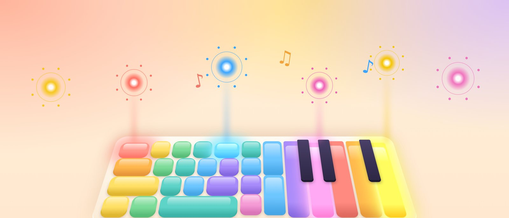
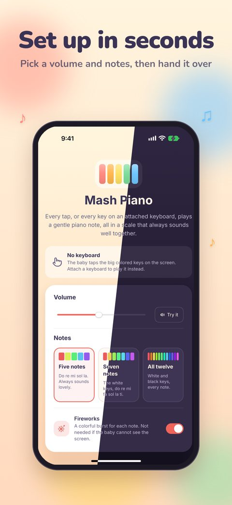
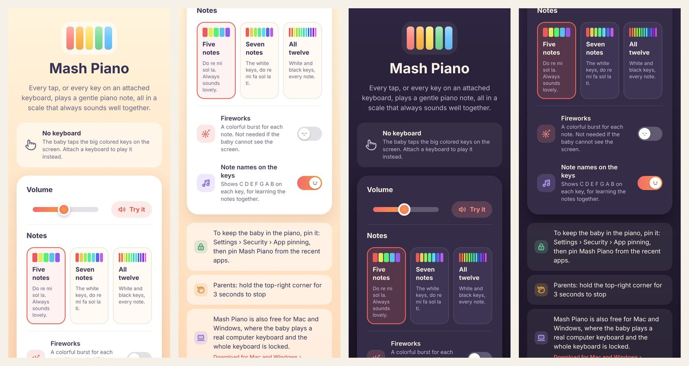

  

<h1 align="center">Mash Piano</h1>

  <b>A piano for babies. However they mash the keys, only gentle music comes out.</b> 
  Turn a spare keyboard, phone or tablet into a toy that can't quit, can't break anything and always sounds lovely.

  
  
  
  

  <a href="https://mashpiano.herosizy.dev">Website</a> ·
  <a href="#download">Download</a> ·
  <a href="#for-parents-how-to-stop">How to stop</a> ·
  <a href="#faq">FAQ</a> ·
  <a href="https://mashpiano.herosizy.dev/zh">中文</a>

  
  
  
  

## Why it exists

It started with an old mechanical keyboard at home. Our baby loved slapping it, so it became a toy. But on a real computer every slap did something: apps quit, windows switched, shortcuts fired, and nothing sounded nice.

Mash Piano turns that keyboard into an instrument. Every key plays a piano note that fits with the others, and nothing else on the computer reacts. On a phone or tablet, the screen becomes rows of big colored keys for little fingers.

## Download

Free, with no ads, no accounts and no in-app purchases.

| Device | Get it |
| --- | --- |
| **iPhone, iPad** (also Apple silicon Macs and Vision Pro) | [App Store](https://apps.apple.com/us/app/mash-piano/id6837722350) |
| **Mac** | [Apple silicon](https://mashpiano.herosizy.dev/download/mac-arm64) · [Intel](https://mashpiano.herosizy.dev/download/mac-x64) |
| **Windows** | [x64 (most PCs)](https://mashpiano.herosizy.dev/download/windows-x64) · [ARM](https://mashpiano.herosizy.dev/download/windows-arm64) |
| **Android** | [APK](https://mashpiano.herosizy.dev/download/android) |

The links always fetch the newest installer. Every file is also on the [Releases](../../releases/latest) page.

> [!TIP]
> On a Mac, the App Store version is the iPad app: a touch piano. To have the baby play a real keyboard with the whole keyboard locked, use the Mac download above.

## What makes it baby-proof

**It always sounds good.** By default every note is in the C major pentatonic scale (do re mi sol la), so any handful of keys is in harmony. Parents can switch to seven notes (the white keys) or all twelve.

**The whole keyboard plays.** Letters, digits, symbols, F1–F12, arrows, the number pad, Ctrl, Alt, Cmd, Shift: every key has its own note, from C1 to C8. Each row up is an octave higher, a row rises from left to right, and a key always plays the same note.

**Nothing escapes.** On a computer the piano takes the full screen and the whole keyboard. Cmd+Q, Alt+F4, Alt+Tab, the Win key, the Dock, Mission Control and the media keys all just play notes. See [what can and can't be blocked](#faq).

**Kind to small ears.** High notes are softer, a slap on a dozen keys plays only a few, and the computer's volume stays at 50% or below while the baby plays, even if headphones or a Bluetooth speaker connect midway.

**A real piano.** Salamander Grand Piano samples, recorded from a Yamaha C5 grand.

**Calm to look at.** Each note is a soft glow of its color. Turn on **Fireworks** for a burst on every note (no two alike), or **Note names on the keys** on phones and tablets to learn C D E F G A B together. The screens follow light and dark mode, and the app speaks 25 languages.

  

## For parents: how to stop

The baby can't leave the piano, but you can, in either of two ways:

- **Hold the top-right corner of the screen for 3 seconds**, with the mouse on a computer or a finger on a phone or tablet.
- **Type `quitpiano`** on the keyboard, with no more than 3 seconds between letters.

Both bring you back to the setup page. On a laptop, turn on **Lock the mouse and trackpad too**: then the pointer stays put, clicks do nothing, and typing `quitpiano` is the only way out.

## Getting started

### Mac and Windows

1. Open **Mash Piano**, set the volume and press **Try it**. The keyboard's volume keys are locked once the baby plays, so set it here first.
2. Press **Start playing (full screen, keyboard locked)** and hand over the keyboard.

<b>Mac details</b>

- Open the `.dmg` and drag Mash Piano into Applications.
- The first time, switch on the **Accessibility** permission: System Settings › Privacy & Security › Accessibility › Mash Piano. macOS lets only apps with this permission catch shortcuts such as Cmd+Q and Cmd+Tab. The app never goes online and records no keys.
- While playing, the Dock, the menu bar, Cmd+Tab, Mission Control, trackpad gestures and the media keys are blocked. Other displays are covered in black.
- If the app ever hangs, force quit with **Cmd+Option+Esc**.

<b>Windows details</b>

- Run the installer. No administrator rights needed.
- While playing, the Win key, Alt+Tab, Alt+F4 and the media keys are blocked. Accessibility shortcuts such as pressing Shift five times, and **Win+L**, are switched off for the session and restored when you stop (or at the next launch, after an unexpected exit).

### iPhone, iPad and Android

Big colored keys the baby can play with every finger at once. Attach a keyboard and the keyboard plays instead. To keep the baby inside the app:

- **iPhone and iPad**: turn on Guided Access (Settings › Accessibility › Guided Access), then triple-click the side button while the piano plays.
- **Android**: turn on app pinning (Settings › Security › App pinning), then pin Mash Piano from the recent apps.

## FAQ

<b>Does it go online or collect anything?</b>

No. It has no accounts, ads, analytics or tracking, and it never connects to the internet. Key presses become sound on the device and are not recorded. See the [privacy policy](PRIVACY.md).

<b>What can't be blocked on a computer?</b>

- **Mac**: the power / Touch ID button, closing the lid, and the buttons of an old Touch Bar. If another app has turned on secure keyboard entry (Terminal, a password field), no app can lock the keyboard, and Mash Piano tells you so.
- **Windows**: Ctrl+Alt+Del (no app can block it), the power button and closing the lid.

<b>The baby can't see the screen. Does that matter?</b>

Not at all. It was made for a baby who only listens. Leave Fireworks off and the screen stays calm.

<b>Will it keep the computer awake?</b>

Yes. The screen stays on and the computer won't sleep while the baby plays.

## Development

Mash Piano is written in Go with [NSGo](https://github.com/nsgo-dev/nsgo): one codebase for Mac, Windows, iPhone, iPad and Android. Every push to `main` publishes a release and sends the iPhone and iPad build to TestFlight. The website lives in [`site/`](site), a Cloudflare Worker. To build it yourself or contribute, see [docs/DEVELOPMENT.md](docs/DEVELOPMENT.md).

## Credits

Piano samples: [Salamander Grand Piano V3](https://archive.org/details/SalamanderGrandPianoV3) by Alexander Holm, [CC BY 3.0](https://creativecommons.org/licenses/by/3.0/). The files in `sound/notes` were trimmed, faded and levelled.
