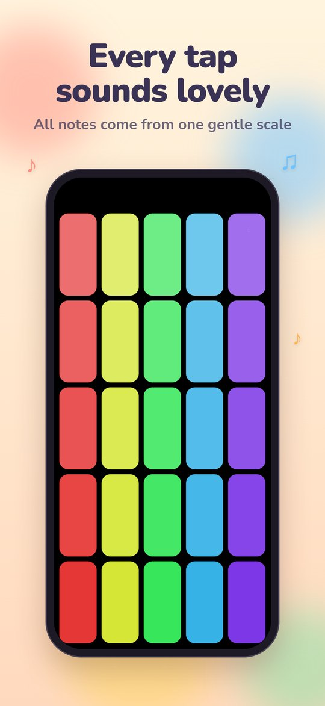
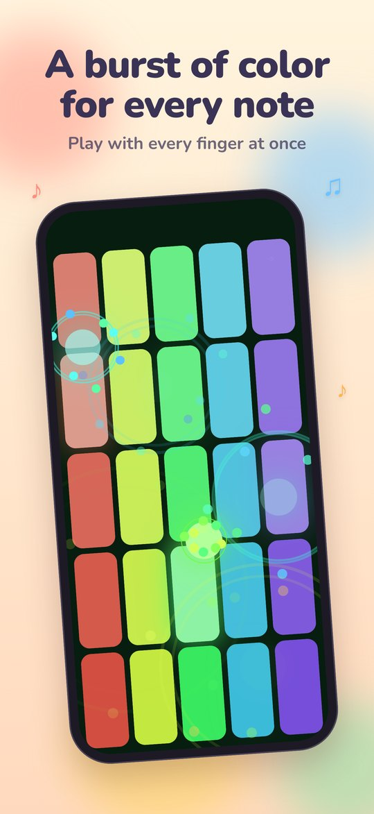
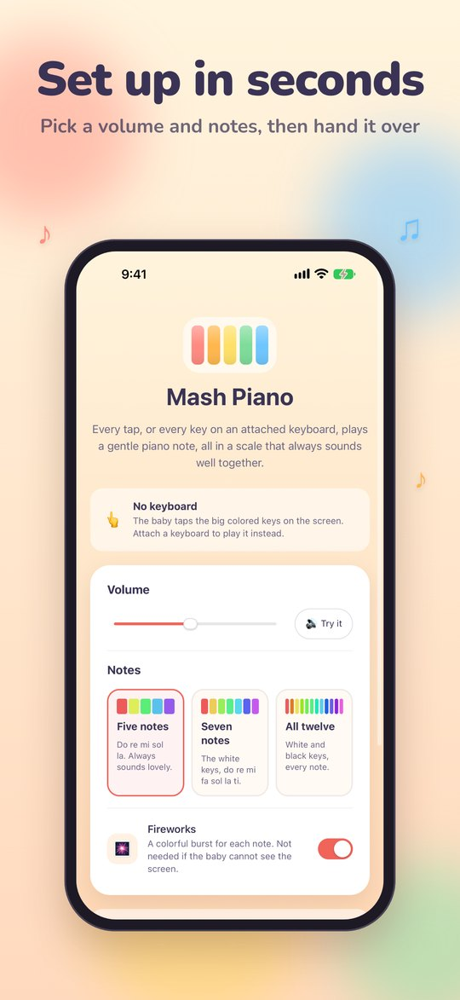
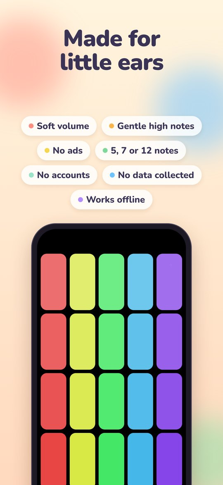

# 🎹 Mash Piano

A piano for babies: however they mash the keys, all that comes out is gentle piano music. On a computer **nothing quits, switches apps or triggers a system shortcut**; on phones and tablets it is rows of big colored keys, and with a keyboard attached the keyboard plays.

For **Mac, Windows, iPhone, iPad and Android**. Free, no ads, no accounts, and it never connects to the network.

| Platform | Get it |
| --- | --- |
| iPhone, iPad (and Apple silicon Macs, Vision Pro) | [App Store](https://apps.apple.com/us/app/mash-piano/id6837722350) |
| Mac | [Apple silicon](https://mashpiano.herosizy.dev/download/mac-arm64) · [Intel](https://mashpiano.herosizy.dev/download/mac-x64) |
| Windows | [x64 (most PCs)](https://mashpiano.herosizy.dev/download/windows-x64) · [ARM](https://mashpiano.herosizy.dev/download/windows-arm64) |
| Android | [APK](https://mashpiano.herosizy.dev/download/android) |

The download links always fetch the newest installer from [Releases](../../releases/latest). The homepage is [mashpiano.herosizy.dev](https://mashpiano.herosizy.dev) (also [in Chinese](https://mashpiano.herosizy.dev/zh)).

  
  
  
  

## Why it exists

It started with an old mechanical keyboard at home. Our baby loved slapping it, so it became a toy. But on a real computer every slap did something: apps quit, windows switched, shortcuts fired, and nothing sounded nice. Mash Piano turns that spare keyboard into an instrument: every key plays a piano note that fits with the others, and nothing else on the computer reacts.

## What it does

- **Mashing sounds good**: by default every note is in the C major pentatonic scale (do re mi sol la), so any combination is in harmony. Parents can switch to seven notes (the white keys) or all twelve. The notes span C1 to C8.
- **The whole keyboard plays**: letters, digits, symbols, F1–F12, arrows, the number pad, Ctrl/Alt/Cmd/Shift… every key has its own note. Each row up is an octave higher, and a row rises from left to right. A key always plays the same note.
- **A real piano sound**: Salamander Grand Piano samples (a Yamaha C5 grand).
- **Kind to small ears**: high notes are quieter; a slap on a dozen keys plays only a few; the computer's volume is capped at 50% while playing, and is pulled back down if a Bluetooth speaker or headphones connect midway.
- **A black screen by default**: the baby only listens. If you like, turn on **Fireworks** and every note bursts into a firework in the color of its pitch.
- The screen stays on and the computer stays awake while playing.
- The app follows the system language, and its setup page follows light or dark mode.

## Computers (Mac, Windows)

1. Open **Mash Piano**, set the volume with the slider and press **Try it** (the keyboard's volume keys are locked once playing starts).
2. Press **Start playing (full screen, keyboard locked)** and hand the keyboard to the baby.
3. **To stop** and go back to the setup page (either works):
   - hold the mouse in the screen's **top-right corner** for **3 seconds** (not available when the mouse is locked);
   - or type **`quitpiano`** on the keyboard (no more than 3 seconds between letters).

On a laptop, turn on **Lock the mouse and trackpad too**: the pointer stays put, clicks do nothing, and the only way out is typing `quitpiano`.

### Mac

- Download `macos-arm64.dmg` (Apple silicon) or `macos-x64.dmg` (Intel) and drag Mash Piano into Applications.
- The first time, grant the **Accessibility** permission (System Settings › Privacy & Security › Accessibility › switch Mash Piano on). macOS lets only apps with this permission intercept system shortcuts such as Cmd+Q and Cmd+Tab. The app never connects to the network and records no keys.
- While playing, the Dock, the menu bar, Cmd+Tab, Mission Control, trackpad gestures and the media keys are all blocked; with several displays, the others are covered in black.
- **What cannot be blocked**: the power / Touch ID button, closing the lid, and the buttons on an old Touch Bar. If another app has turned on secure keyboard entry (Terminal, a password field), the keyboard cannot be locked, and the app says so.
- If the app ever hangs: force quit with **Cmd+Option+Esc**.

### Windows

- Download and run `windows-x64-setup.exe` (most PCs) or `windows-arm64-setup.exe` (ARM PCs). No administrator rights needed.
- While playing, the Win key, Alt+Tab, Alt+F4 and the media keys are blocked; accessibility shortcuts such as pressing Shift five times and **Win+L (lock screen)** are switched off for the session and restored on exit (after an unexpected exit, the next launch restores them).
- **What cannot be blocked**: Ctrl+Alt+Del (no app can), the power button, and closing the lid.

## Phones and tablets (iPhone, iPad, Android)

Big colored keys the baby can play with every finger, several at once. Attach a keyboard and the keyboard plays too. Parents hold the top-right corner for 3 seconds (or type `quitpiano` on an attached keyboard) to return to the setup page. The setup page also has a **Download for Mac and Windows** link, for when there is a spare computer keyboard at home.

- **iPhone / iPad**: get it from the [App Store](https://apps.apple.com/us/app/mash-piano/id6837722350). To keep the baby in the app, turn on Guided Access: Settings › Accessibility › Guided Access, then triple-click the side button while the piano plays.
- **Android**: download and install the `.apk`. To keep the baby in the app, turn on app pinning: Settings › Security › App pinning, then pin Mash Piano from the recent apps.

## Credits

Piano samples: [Salamander Grand Piano V3](https://archive.org/details/SalamanderGrandPianoV3) by Alexander Holm, [CC BY 3.0](https://creativecommons.org/licenses/by/3.0/). The files in `sound/notes` were trimmed, faded and levelled.

## Privacy

Mash Piano collects nothing and never goes online. See [PRIVACY.md](PRIVACY.md).

## Development

The app is written in Go with [NSGo](https://github.com/nsgo-dev/nsgo), one codebase for every platform. Every push to `main` publishes a release and sends the iPhone/iPad build to TestFlight. The homepage lives in [`site/`](site), a Cloudflare Worker that Cloudflare deploys by itself. To build it yourself or contribute, see [docs/DEVELOPMENT.md](docs/DEVELOPMENT.md).
